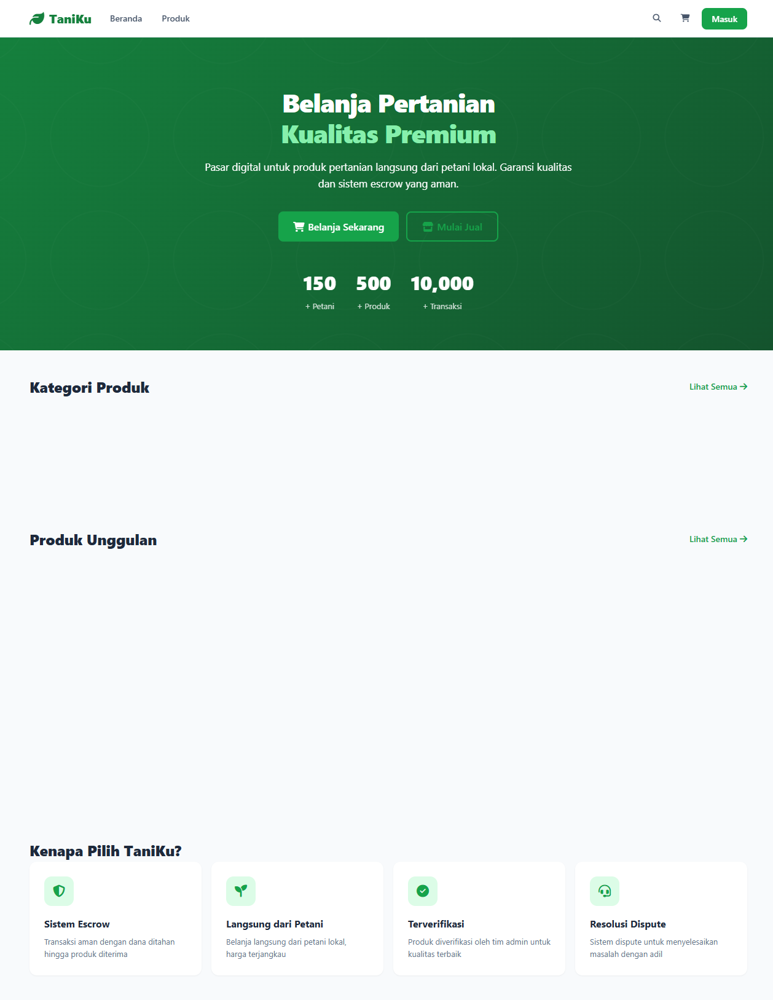
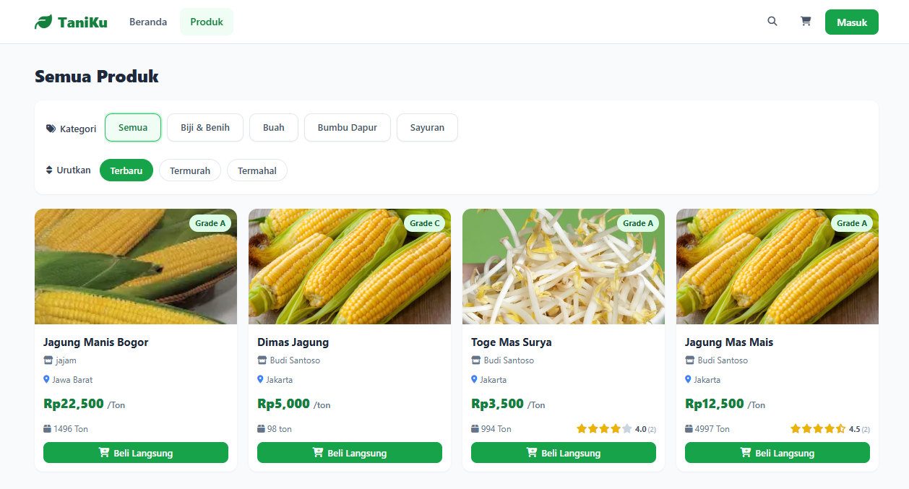
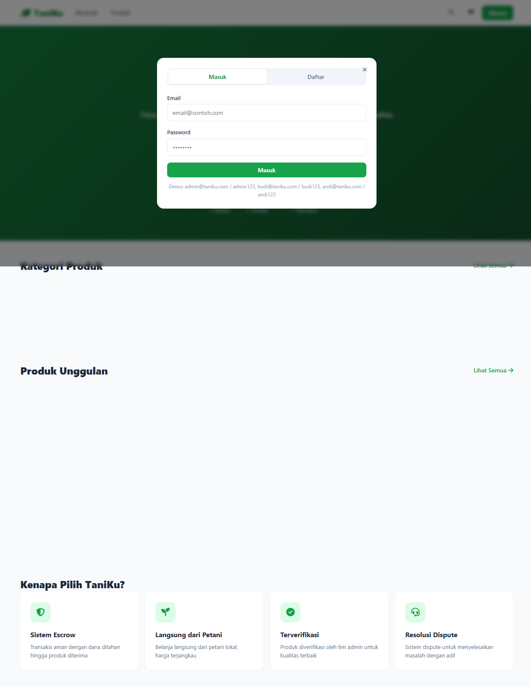
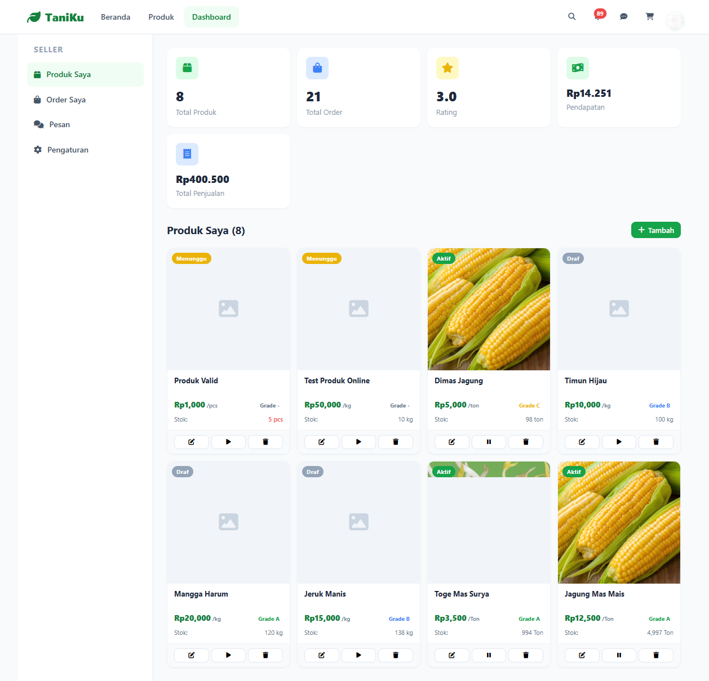
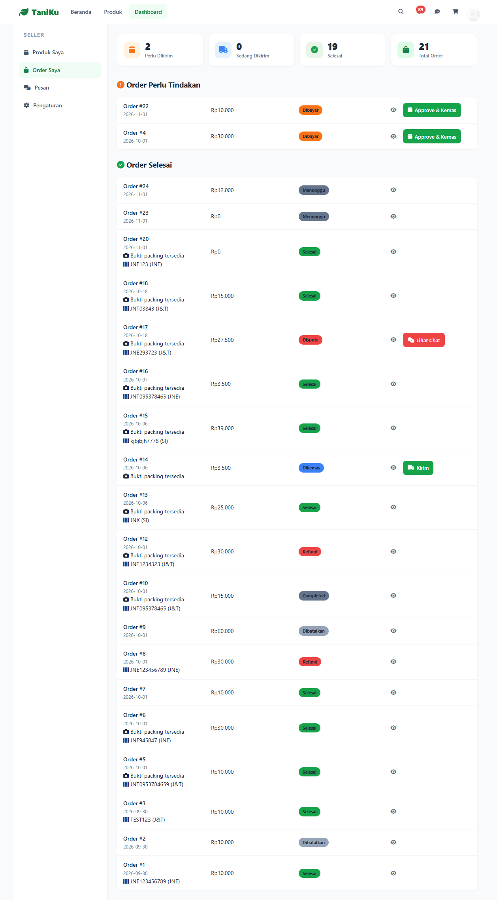
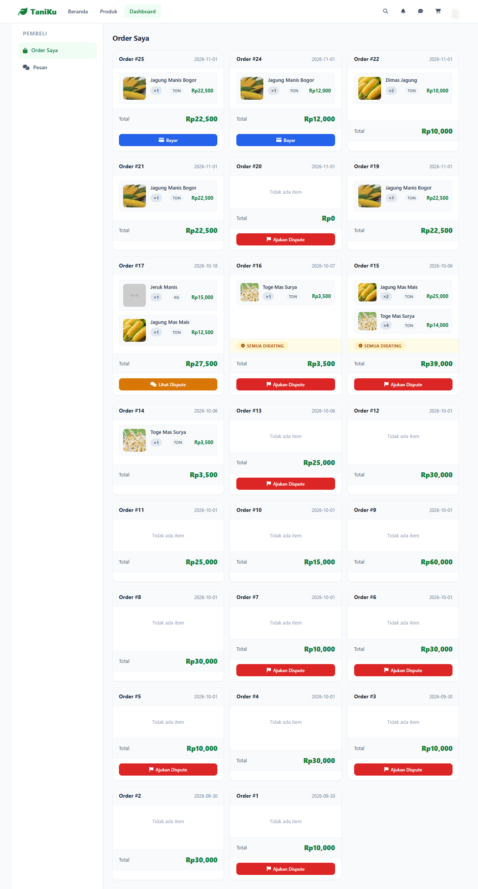

# 🌾 TaniKu — Marketplace Pertanian dengan Sistem Escrow

<p align="center">
  
</p>

<p align="center">
  <b>TaniKu</b> adalah marketplace digital untuk produk pertanian yang menghubungkan <b>petani/seller</b> dengan <b>pembeli</b> secara langsung. Dibangun dengan <b>Laravel</b> (backend) + <b>Alpine.js / Vanilla JS</b> (frontend) dan dilengkapi <b>sistem escrow</b> serta <b>resolusi dispute</b> agar transaksi aman dan adil.
</p>

<p align="center">
  
  
  
  
</p>

---

## 🎯 Fitur Utama

### Untuk Pembeli (Buyer)
- **Belanja produk pertanian** langsung dari petani lokal — harga kompetitif, tanpa perantara.
- **Filter & pencarian produk** berdasarkan kategori (Biji & Benih, Buah, Bumbu Dapur, Sayuran) dan pengurutan (Terbaru / Termurah / Termahal).
- **Keranjang & checkout** dengan validasi stok otomatis.
- **Sistem escrow**: dana ditahan oleh platform sampai barang diterima — uang aman.
- **Negosiasi harga** (tawar-menawar) langsung dengan seller lewat chat.
- **Rating & ulasan** produk setelah transaksi selesai (1–5 bintang).
- **Pelacakan pengiriman** via nomor resi + jasa kirim.
- **Ajukan dispute** jika ada masalah pada pesanan; selesaikan secara adil oleh admin.
- **Notifikasi realtime** untuk setiap perubahan status pesanan.

### Untuk Seller / Petani
- **Dashboard khusus seller** dengan statistik: total produk, total order, rating, pendapatan, total penjualan.
- **Kelola produk**: tambah / edit / hapus, set harga, stok, satuan (kg, pcs, ikat, ton), dan grade (A/B/C).
- **Verifikasi produk oleh admin** — produk dipublikasikan setelah disetujui (status: Draft → Menunggu → Aktif / Ditolak).
- **Manajemen order**: approve & kemas, kirim dengan input resi + jasa kirim, konfirmasi penerimaan.
- **Chat & negosiasi** dengan pembeli (terima / tolak / bandingkan harga).
- **Pantau dana escrow** dan pencairan setelah buyer konfirmasi terima barang.

### Untuk Admin
- **Verifikasi produk** seller (approve / reject dengan alasan).
- **Manajemen semua pengguna & pesanan**.
- **Resolusi dispute**: refund penuh, partial release, atau full release dana escrow — dengan validasi jumlah dana.
- **Pencairan escrow** ke seller setelah order selesai.

---

## 🔒 Sistem Escrow & Keamanan Transaksi

TaniKu menggunakan **escrow 3-pihak** yang melindungi kedua belah pihak:

```
Pembeli Bayar  →  Dana Ditahan (Escrow)  →  Seller Kirim Barang
                                              ↓
Pembeli Terima Barang → Konfirmasi → Admin Release → Dana Cair ke Seller
```

- Dana **tidak langsung** ke seller — ditahan platform sampai buyer konfirmasi terima.
- Jika ada masalah, buyer bisa **ajukan dispute**; admin memutuskan: refund, partial release, atau full release.
- Setiap perpindahan dana tercatat & transparan.

---

## 🧭 Alur Penggunaan

### Alur Pembeli (Buyer)
```
Daftar/Login → Jelajahi & Cari Produk → Filter Kategori/Sortir
  → Buka Detail Produk → (Opsional) Negosiasi Harga via Chat
  → Masukkan Keranjang → Checkout → Bayar (Dana Masuk Escrow)
  → Seller Approve & Kirim (Resi) → Terima Barang → Konfirmasi Terima
  → Rating & Ulasan Produk
```
Jika ada masalah saat menerima barang → **Ajukan Dispute** → Admin Resolusi (Refund / Partial / Full Release).

### Alur Seller / Petani
```
Daftar/Login → Lengkapi Profil Toko → Tambah Produk (Harga, Stok, Grade)
  → Admin Verifikasi (Draft → Menunggu → Aktif / Ditolak)
  → Terima Order → Approve & Kemas (Foto Packing) → Kirim (Resi + Jasa Kirim)
  → Buyer Konfirmasi → Terima Dana Escrow
  → (Opsional) Balas Negosiasi Harga / Chat dengan Buyer
```

### Alur Admin
```
Login Admin → Verifikasi Produk Seller → Kelola Pesanan
  → Resolusi Dispute (Refund / Partial / Full Release)
  → Release Escrow → Dana Cair ke Seller
```

---

## 📸 Preview Sistem

### Halaman Beranda (Landing)
<p align="center">
  
</p>

### Halaman Produk (Marketplace)
<p align="center">
  
</p>

### Login / Daftar
<p align="center">
  
</p>

### Dashboard Seller
<p align="center">
  
</p>

### Order Seller
<p align="center">
  
</p>

### Order Buyer
<p align="center">
  
</p>

---

## 🛠️ Teknologi

- **Backend**: Laravel 11.x, PHP 8.3
- **Frontend**: Vanilla JS / Alpine.js, HTML5, CSS3 (responsive, mobile-friendly)
- **Database**: SQLite (default) / MySQL (produksi)
- **Ikon**: Font Awesome 6
- **Deploy**: Docker / Render (tersedia konfigurasi)

## 🚀 Menjalankan Secara Lokal

```bash
# 1. Install dependensi
composer install

# 2. Salin env & buat key
cp .env.example .env
php artisan key:generate

# 3. Migrasi & seed data demo
php artisan migrate --seed

# 4. Jalankan server
php artisan serve
# atau
php -S 127.0.0.1:8787 -t public
```

## 👤 Akun Demo

| Role  | Email             | Password  |
|-------|-------------------|-----------|
| Admin | admin@taniku.com  | admin123  |
| Seller| budi@taniku.com   | budi123   |
| Buyer | andi@taniku.com   | andi123   |

---

<p align="center">
  Dibangun dengan ❤️ menggunakan <b>Laravel</b>. Escrow aman, harga adil, langsung dari petani.
</p>
